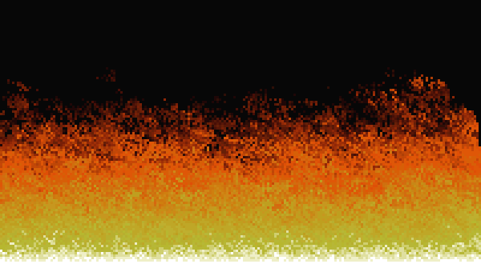

# Fuego de DOOM en JavaScript

El efecto de fuego clásico de DOOM (versión PSX) en un solo `index.html`: una paleta de 37 colores, un arreglo de números y unas cuantas líneas de JavaScript. Sin shaders ni física: cada pixel toma el calor del de abajo, se enfría un poco y se corre al azar.

Demo: https://blissito.github.io/fuego-doom/

Hecho con [Ghosty Studio](https://www.ghosty.studio/c).
